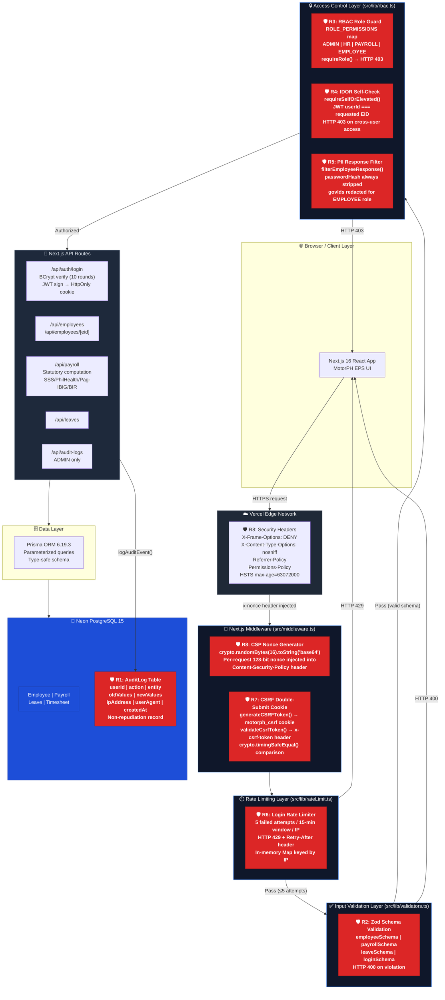

# MotorPH EPS — Security Architecture Diagram (Mermaid Source)
## IAS2 Controls R1–R8 | Group 8 CTRL+ALT+ELITE

## Security Pillar Mapping

| Control | Security Pillar | Implementation |
|---------|----------------|----------------|
| **R1 AuditLog** | Accountability + Non-Repudiation | Immutable DB records with who/what/when/IP |
| **R2 Zod** | Integrity | Schema validation blocks malformed/malicious input |
| **R3 RBAC** | Confidentiality | Role-scoped data access via JWT claims |
| **R4 IDOR** | Confidentiality | Self-check prevents horizontal privilege escalation |
| **R5 PII Filter** | Confidentiality | passwordHash stripped; govIds redacted by role |
| **R6 Rate Limit** | Authenticity | Brute-force prevention on identity verification |
| **R7 CSRF** | Integrity | Double-submit cookie stops forged state mutations |
| **R8 Headers/CSP** | Integrity + Confidentiality | Nonce CSP, HSTS, X-Frame-Options, CORS lockdown |
